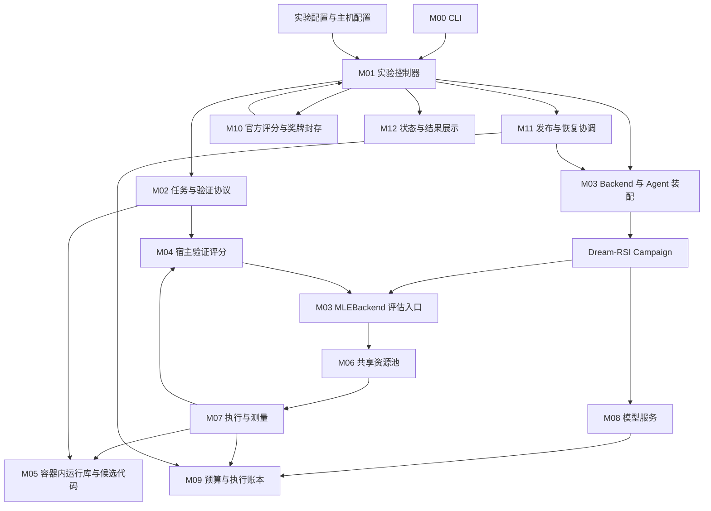
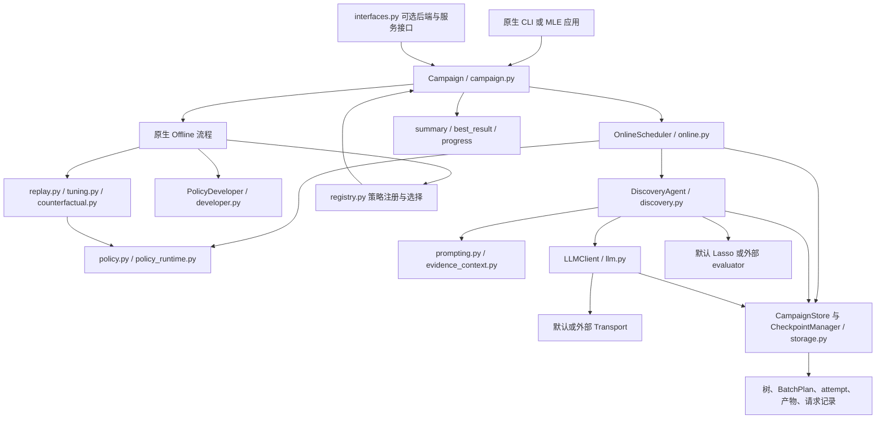
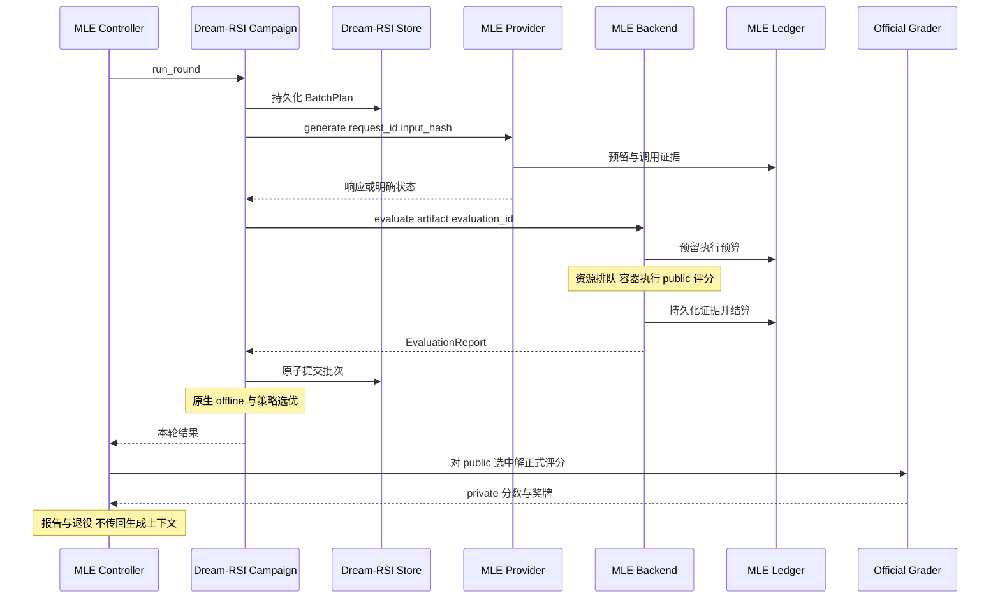

# Dream-RSI 与 MLE 实验平台设计草案

日期：2026-10-18。状态：设计评审，尚未实施。

目标是保留 Dream-RSI 原生架构，将其作为通用 RSI agent；`mle-rsi-experiments` 负责 MLE-bench 特有的任务、资源调度、执行、评测和实验管理。把当前实际需要的 rsi-eval 功能合入 MLE 仓库，取消该 submodule 依赖。现有代码作为能力和故障案例的参考，不逐行搬运，不要求复刻所有历史工作流。

本设计使用统一编号：D01–D12 表示 Dream-RSI 差异，M00–M12 表示 MLE 模块，C01–C26 表示历史改动归属。改动归属表是总清单，原生能力与最小差异表是其 Dream-RSI 部分的展开，不是两套独立需求。

## 1 核查基线

### 1.1 远端分支已验证

2026-10-18 09:38 UTC 前后，使用 `/mnt/afs/yangsen1/.github-ssh/id_ed25519` 及同目录 `known_hosts`，通过 SSH 只读执行 `git ls-remote`，确认以下结果。没有读取或复制私钥内容，没有 fetch、切换分支或修改 submodule。

| 远端引用 | 实际 commit |
|---|---|
| `HEAD`、`refs/heads/main` | `3ccf88a209604795f75ec2e0f2f40352dc80b620` |
| `refs/heads/mle-spooky-solver-500` | `6d27aa3f5ae39ae86a924a3794a116f8388a114e` |
| `refs/heads/mle-spooky-diversity` | `72e8d105eaec6d07af7a5a78acd558475077ce2f` |

仓库为用户确认的 [3365538768/wsl-dream-rsi](https://github.com/3365538768/wsl-dream-rsi)。远端 main 与已调研的本地 main 完全同 SHA，因此先前因 HTTPS 认证失败而保留的“可能不是最新 main”限制已解除。本设计固定上述 commit，不追踪未来浮动的 main。

可重复执行的只读命令如下；凭据只按路径交给 SSH 使用：

```bash
GIT_SSH_COMMAND='ssh -i /mnt/afs/yangsen1/.github-ssh/id_ed25519 -o IdentitiesOnly=yes -o UserKnownHostsFile=/mnt/afs/yangsen1/.github-ssh/known_hosts -o StrictHostKeyChecking=yes -o BatchMode=yes' \
git ls-remote git@github.com:3365538768/wsl-dream-rsi.git \
  HEAD refs/heads/main refs/heads/mle-spooky-solver-500 refs/heads/mle-spooky-diversity
```

### 1.2 开发演进与当前代码

```text
main / mle-integration-baseline：3ccf88a
└── 本地 mle-task-adapter 开发链
    ├── f011f78：外部 MLE backend 与 generation transport
    ├── 37b9565、4d7c525、1962ccf：MLE 指标与展示
    └── 6d27aa3：修复约束、长历史证据
        │ 远端发布分支：mle-spooky-solver-500
        └── 72e8d10：候选去重接口与有限重新生成
            │ 远端发布分支：mle-spooky-diversity
            └── 当前 submodule 工作树上的后续 runtime 补丁
```

| 对象 | 路径与状态 |
|---|---|
| 原生 main 本地源码 | `/mnt/afs/yangsen1/projects/wsl-dream-rsi`，main 为 `3ccf88a` |
| MLE 开发仓库 | `/mnt/afs/yangsen1/projects/mle-rsi-experiments`，`bug-fix`，HEAD 为 `7f948d582d5600f07219a10f371d0b3ad5bf73bc`，存在未提交及未跟踪修改 |
| 开发 submodule | 主仓库下 `third_party/dream-rsi`，detached HEAD `72e8d10`，叠加补丁 |
| 当前实验代码快照 | `/mnt/afs/yangsen1/experiments/lite22-aptos-kfold-001/code`，无 `.git` |
| Diversity 当时的开发副本 | `/mnt/afs/yangsen1/projects/mle-rsi-spooky-diversity/third_party/dream-rsi`，本地 `mle-task-adapter` 上产生 `72e8d10` |

当前 Dream-RSI 工作树相对 `3ccf88a`：**19 个文件，新增 572 行、删除 177 行**。统计包含已有提交和当前补丁，不能只比较 `72e8d10` 与 main。

运行快照与开发仓库共有的运行源码一致；运行快照内 121 个冻结源码/提示词文件全部符合其 frozen-config。两边文档、测试、补丁 manifest 存在差异，开发仓库额外有恢复辅助代码。运行快照的 Dream-RSI patch manifest 对 `campaign.py`、`llm.py`、`online.py`、`policy_runtime.py` 已滞后，但这些实际源码符合实验自己的冻结哈希。新实现应以正常 Git 提交和统一发布记录消除这种双重版本身份。

### 1.3 主要源码依据

- 原生 [campaign.py](https://github.com/3365538768/wsl-dream-rsi/blob/3ccf88a209604795f75ec2e0f2f40352dc80b620/my_rsi/src/dream_rsi/campaign.py)：装配、bootstrap、run_round、offline、run。
- 原生 [online.py](https://github.com/3365538768/wsl-dream-rsi/blob/3ccf88a209604795f75ec2e0f2f40352dc80b620/my_rsi/src/dream_rsi/online.py)：批次决策、并发 expand、完成批次提交。
- 原生 [storage.py](https://github.com/3365538768/wsl-dream-rsi/blob/3ccf88a209604795f75ec2e0f2f40352dc80b620/my_rsi/src/dream_rsi/storage.py)：records/rounds、attempt、UsageLedger、CheckpointManager。
- 原生 [discovery.py](https://github.com/3365538768/wsl-dream-rsi/blob/3ccf88a209604795f75ec2e0f2f40352dc80b620/my_rsi/src/dream_rsi/discovery.py)：parent/context 哈希校验、已有 attempt 复用、生成和评估。
- 原生 [llm.py](https://github.com/3365538768/wsl-dream-rsi/blob/3ccf88a209604795f75ec2e0f2f40352dc80b620/my_rsi/src/dream_rsi/llm.py)：请求持久化、原生生成和错误处理。
- 原生 [models.py](https://github.com/3365538768/wsl-dream-rsi/blob/3ccf88a209604795f75ec2e0f2f40352dc80b620/my_rsi/src/dream_rsi/models.py)：TaskSpec、EvaluationReport、AttemptRecord、BatchDecision。
- 当前 [MLEBackend](../mle_rsi/backend.py)、[运行控制器](../mle_rsi/rounds.py)、[验证实现](../mle_rsi/validation.py)、[运行时补丁清单](../patches/runtime/manifest.json)。
- 恢复故障与旧实现边界见 [HANDOFF](../HANDOFF.md)、[stage2](stage2.md)、`docs/evidence/20261018-whole-round-recovery/`。历史脚本是证据，不是新实现入口。

## 2 职责与最小实现边界

| 仓库 | 负责 | 不负责 |
|---|---|---|
| Dream-RSI | 通用搜索树、候选生成流程、策略、online/offline、回放、搜索状态持久化与恢复 | MLE 数据格式、奖牌、GPU 池、Docker、美元账本、服务商 HTTP 特例 |
| mle-rsi-experiments | MLE 任务、验证、容器执行、共享资源、模型服务、预算、正式评分、跨题控制、部署 | 自己实现搜索树、直接修补 Dream-RSI 数据库、复制一套 offline 引擎 |

基本原则：

1. 保留 Dream-RSI 原生目录和主要类，只补必要接口与可靠性修复。
2. 首版实现可靠的单任务闭环，再增加多题协调；不先做大而全的插件系统。
3. 正常恢复属于首版；旧历史迁移、跨阶段分叉和任意整轮回退单独实施。
4. Public 验证结果进入搜索；private 正式评分仅用于报告和奖牌退出，不进入模型上下文或倒选候选。
5. 算法优化与接口/可靠性修改分开提交，默认策略不因模块整理而变化。
6. 当前实验保持冻结；新实现用新 run 验证，不覆盖运行源码、不清空旧账本。

原生 main 已有 online/offline、回放、调参、反事实评估、策略沙箱、attempt 持久化、检查点、批次原子提交及原生 Web。核心缺口是 Campaign 仍直接装配 Lasso，以及“已经产生 attempt，但批次尚未提交”时缺少稳定的批次计划。

## 3 原生能力与最小差异表

Dream-RSI 路径相对于 `my_rsi/src/dream_rsi/`。首版指可靠的 MLE 接入版本，不等于全部历史功能等价重建。

| ID | 能力 | 原生 main | 现有开发与缺口 | 最小改动 | 文件 | 阶段 |
|---|---|---|---|---|---|---|
| D01 | 外部任务接入 | TaskSpec 已通用，Campaign 直接创建 Lasso sampler/evaluator/seed | 已有 task_backend，但部分 Lasso 对象先创建再覆盖 | 定义 Backend 接口；外部模式跳过 Lasso 装配，默认路径保持 | `campaign.py`、新增 `interfaces.py` | 首版 |
| D02 | 模型服务注入 | LLMClient 有原生生成和 mock，无正式外部 transport 构造入口 | 已有 transport，外层仍有构造后赋值 | 从 Campaign 构造入口注入，保留原生请求持久化 | `campaign.py`、`llm.py`、`interfaces.py` | 首版 |
| D03 | 未提交批次恢复 | attempt 持久化；commit_round 原子提交节点/树/收据 | 恢复时可能重新选父，与旧 attempt 冲突 | 执行前保存 BatchPlan；复用计划和策略状态；提交时原子完成计划 | `models.py`、`online.py`、`storage.py`、`policy_runtime.py` | 首版 |
| D04 | 失败分类 | 已有超时、ExternalUnknown、请求证据 | 504 特判进入核心；完整性错误可能被当普通部分失败 | 区分候选失败、未发送、未知、允许跳过、完整性错误、主动停止；HTTP 语义移到外层 | `errors.py`、`llm.py`、`discovery.py`、`online.py`、`campaign.py` | 首版 |
| D05 | 控制与查询 | 已有 run/run_round、progress、checkpoint | 动态挂 before/after batch，外层直接读内部状态 | 显式控制检查、批次排空、summary/best_result；复用原生 progress | `campaign.py`、`online.py`、`progress.py`、`interfaces.py` | 首版 |
| D06 | 通用提示与上下文 | 有 task_contract，但部分提示仍面向 Lasso runtime 优化 | 已改 MLE 提示、压缩参考代码、累计树去重 | 核心引用 task 目标/契约；必需父代码保留；累计历史不重复；超预算先拒绝 | `prompting.py`、`evidence_context.py`、`online.py` | 首版 |
| D07 | 策略与回放超时 | 有隔离/超时，诊断与分类不充分 | 已加输入大小/stderr、回放超时恢复 | 明确错误类型与证据；回放超时不算低分；存在有效 incumbent 时显式保留 | `policy_runtime.py`、`errors.py`、`replay.py`、`campaign.py` | 首版 |
| D08 | 空根与结果输出 | 原生模型已有 evaluated/valid/metrics，但默认先评估 Lasso seed | 外层用 placeholder、过滤和 UI 特判 | 用已有字段明确未评估根语义，统一过滤；返回 raw metric 和 search score | `campaign.py`、`interfaces.py`；必要时 `models.py` | 首版 |
| D09 | 修复与探索规则 | 原生策略/回放已有扩展基础 | repair_guard、排序规则、外层停滞 draft/fallback | 独立可选规则；online/replay 同义；不强制改变默认策略 | `repair_guard.py`、`policy.py`、`policy_runtime.py`、`tree.py`、`config.py`、`models.py`、`replay.py` | 可选 |
| D10 | 去重 | 无当前 novelty gate | gate 在核心，AST 及角色在外层 | 需要时提供通用 gate，Python AST 为具体实现；有界再生成 | `discovery.py`、`interfaces.py`，可新增 `novelty.py` | 可选 |
| D11 | 历史继承与分叉 | 有 checkpoint，配置和协议不可变；无完整跨阶段导入 | 外层复制/裁剪 DB、继承 protocol | 校验后的检查点导出/分叉，新 campaign、新 namespace；不提供无校验原地删表 | `campaign.py`、`storage.py`，可新增 `checkpoint_io.py` | 后续 |
| D12 | Offline 强度 | 调参、回放、反事实原生已有 | 外层 baseline/light/max、独立 refresh、实际次数记录 | 强度作为外层配置；实际次数从原生记录汇总；可靠性归 D07 | 通常无需新增核心文件 | 配置为主 |

### 3.1 逐文件改动估算

以下为相对远端 main `3ccf88a` 的新增加删除行数估算，不是净增量，也不是已实现 diff。同一文件跨多个 D 项只计一次。范围覆盖 D01–D08，不含可选优化、旧数据兼容与测试。

| 文件 | 对应需求 | 预计改动行数 |
|---|---|---:|
| 新增 `interfaces.py` | D01/D02/D05/D08 | 60–100 |
| `campaign.py` | D01/D02/D04/D05/D07/D08 | 130–220 |
| `online.py` | D03/D04/D05/D06 | 90–150 |
| `storage.py` | D03 | 60–100 |
| `models.py` | D03/D08 | 20–40 |
| `llm.py` | D02/D04 | 40–70 |
| `discovery.py` | D04 | 25–50 |
| `errors.py` | D04/D07 | 15–30 |
| `prompting.py` | D06 | 30–60 |
| `evidence_context.py` | D06 | 10–25 |
| `policy_runtime.py` | D03/D07 | 35–65 |
| `replay.py` | D07 | 20–40 |
| `progress.py` | D05 | 15–30 |
| **生产代码合计** | **D01–D08** | **550–980** |

| 测试文件，位于 `my_rsi/tests/` | 验收内容 | 预计行数 |
|---|---|---:|
| `test_external_backend.py` | 外部接入、原生 Lasso 路径、空根过滤 | 100–160 |
| `test_batch_recovery.py` | 各中断点、批次计划、策略状态、提交冲突 | 180–300 |
| `test_external_transport.py` | 未发送/未知/跳过、恢复不重复请求 | 100–180 |
| `test_agent_control.py` | 批次排空、offline 停止点、查询 | 80–140 |

后续独立估算：D09 合计约 120–220 行；D10 约 80–140 行；D11 约 150–300 行，旧数据兼容测试另计。D12 优先用外层配置实现。实际实现若明显超过范围，应重新审查是否引入了首版不需要的兼容层或框架。

### 3.2 保持不动的原生模块

默认 Lasso 的 `evaluation.py`、`datasets.py`、runner 保留；MLE 外部后端不走其装配路径。`developer.py`、`tuning.py`、`counterfactual.py` 首版不因接入而重构。原生 `web/` 不识别 MLE 状态，不再注入 MLE 专用 monkey patch。配置已存在的能力直接使用，不再定义一套平行配置系统。

## 4 改动归属总表

这张表覆盖现有运行相关功能、已提交开发链、runtime 补丁和近期未提交修复。它是功能级迁移清单，不是逐行代码搬运清单。每项旧修改都须落在某一行；历史操作脚本可转为测试案例或归档证据。

| ID | 历史改动或问题 | 来源参考 | 目标仓库和模块 | 处理决定 |
|---|---|---|---|---|
| C01 | MLE backend、任务、空根、指标方向 | `backend.py`、`experiment.py`，f011f78 | Dream D01/D08；MLE M02/M03 | 整理接口，保留必要行为 |
| C02 | GPT/Gemini 注入与账单 | `provider.py`、`gpt_provider.py`、`llm.py` | Dream D02/D04；MLE M08/M09 | 核心通用接口；首版只实现当前需要的 provider |
| C03 | 槽位与节点数、父节点冲突、部分失败 | `round_slot_evidence`、`online.py`、`discovery.py` | Dream D03/D04 | 核心负责完整性，外层不重建校验规则 |
| C04 | 回退漏删 rounds、重复收据 | `rollback_repair.py`、整轮恢复证据 | Dream D03/D11；MLE M09/M11 | 正常恢复首版；历史分叉后续；旧脚本归档 |
| C05 | 504、连接失败、未知请求、退避 | `gpt_provider.py`、`llm.py`、skip 记录 | Dream D04；MLE M08/M09 | HTTP 处理归 MLE；跳过与费用结算分开 |
| C06 | 长祖先、累计整树重复、上下文溢出 | `evidence_context.py`、`prompting.py`、`online.py` | Dream D06 | 保留通用修复与省略证据 |
| C07 | 策略进程诊断、offline timeout | `policy_runtime.py`、`replay.py`、Campaign | Dream D07 | 不以 timeout 伪造策略低分 |
| C08 | 有限修复、best-first 排序、停滞与 fallback | `repair_guard.py`、`policy.py`、`policy_recovery.py` | Dream D09 | 后置独立选项；首次版本保留原生策略 |
| C09 | AST 去重、再生成、角色提示 | `diversity.py`、novelty gate | Dream D10；MLE M02 | 通用 gate 可选；具体实验角色留在任务契约 |
| C10 | 相同预测诊断 | `diversity.py`、`evidence.py` | MLE M04；Dream 用通用 diagnostics | 不把 validation/submission 特判写进核心 |
| C11 | baseline/light/max、反事实及实际次数 | `offline_max.py`、`offline_tiers.py` | Dream D12；MLE M01/M12 | 使用原生算法配置，独立 refresh 后置 |
| C12 | 多题独立轮次、API 并发 | `rounds.py`、`experiment.py` | MLE M01/M08；Dream D05 | 一套控制器，不复制 agent 搜索循环 |
| C13 | 得牌退出、Dog 排除、暂停/停止 | `medal_retirement.py`、`rounds.py` | MLE M01/M10；Dream D05 | 业务在外层，agent 提供安全停点 |
| C14 | 物理核、混合槽位、GPU 请求 | `round_resources.py`、`adaptive_resources.py` | MLE M06/M07 | 一个资源池；候选资源请求在外层解析 |
| C15 | 容器 top/kill 竞态、中断测量 | `execute.py`、`bench_container.py` | MLE M07/M09 | 吸收运行所需代码；保留 container ID 和测量证据 |
| C16 | AFS、UID、只读输入权限 | `mount_permissions.py`、执行器 | MLE M07 | 主机适配，不进入 agent |
| C17 | 全局/每题 API、执行/GPU 预算、追加额度 | `common.py`、`stage2.py` | MLE M09/M01 | 一个资金账本，保留未知预留 |
| C18 | 固定验证、submission 校验、宿主评分 | `validation.py`、`backend.py` | MLE M02/M04 | 保留，统一评估链路 |
| C19 | Cactus/APTOS 三折、重复图片组 | `validation.py`、`kfold.py`、`selection_review.py` | MLE M02/M04/M05 | 验证协议能力；复核实验作为独立配置 |
| C20 | 验证/最终训练一致、完整输出 | `candidate_contract.py`、`candidate_runtime.py` | MLE M05/M04 | 保留契约及宿主验证；不能声称证明任意代码内部语义 |
| C21 | 900/1800/3600 秒、确定性缓存 | 配置、`candidate_runtime.py` | MLE M01/M05/M07 | 时限配置化；缓存后置 |
| C22 | 正式评分、pandas 兼容、奖牌 | `grade_selected`、`mle_grade.py` | MLE M10 | 使用官方 grader，兼容包装进独立进程 |
| C23 | 阶段继承、跨机、共享存储迁移 | `stage2.py`、`restart_task.py`、`migrate_rounds.py` | MLE M11/M09；Dream D11 | 发布与正常恢复首版；旧历史迁移独立验收 |
| C24 | 原始分数、空根隐藏、总览/树/资源页 | `round_dashboard.py`、`round_viewer.py`、原生 Web 改动 | MLE M12；Dream D05/D08 | 首版统一 CLI/JSON；复杂页面后置 |
| C25 | Spooky 队列、guarded dev/final、专用启动器 | `single_task.py`、`queue_single.py`、`supervisor.py`、ops | MLE M01/M11 | 不逐个移植历史入口；必要工作流后续配置化 |
| C26 | 版本补丁、冻结源码、rsi-eval suite | patch manifest、source_manifest、FML/ALE | MLE M11；两仓各自 Git 提交 | 正常提交替代 patch；不迁入无关 suite |

## 5 MLE 目标架构



M04 返回 public 验证结果给 agent；M10 的 private 结果只返回控制器。图中的调用方块是职责，不要求每个方块成为独立包或服务。所有组件仍可以运行在一个控制器进程与若干执行子进程中。

### 5.1 目标目录

```text
mle-rsi-experiments/
├── pyproject.toml
├── src/
│   └── mle_rsi/
│       ├── __main__.py
│       ├── config.py
│       ├── controller.py
│       ├── tasks.py
│       ├── backend.py
│       ├── validation.py
│       ├── runtime.py
│       ├── resources.py
│       ├── execute.py
│       ├── containers.py
│       ├── process.py
│       ├── provider.py
│       ├── ledger.py
│       ├── recovery.py
│       ├── grading.py
│       ├── grade_worker.py
│       ├── release.py
│       ├── reporting.py
│       └── io.py
├── configs/
│   ├── experiments/
│   └── hosts/
├── tests/
│   ├── unit/
│   ├── integration/
│   └── fixtures/
├── docs/
│   └── rsi-agent-mle-architecture-design.md
└── third_party/
    └── dream-rsi/
```

只保留 Dream-RSI submodule，固定新开发分支的准确 commit，并通过 Python 包安装使用。移除导入时修改 sys.path 的做法。数据、模型、凭据、run 输出不进入源码包。

### 5.2 模块与文件对应

下列行数为目标生产文件总长度估算，包含迁入/复用/重写，不是相对旧代码的新增行数。不要与 Dream-RSI 的 diff 行数相加。

| 模块 | 文件和估算行数 | 职责与来源 |
|---|---|---|
| M00 入口 | `__main__.py` 60–100 | 一套 init/run/status/stop 入口，不重复历史启动器 |
| M01 控制 | `config.py` 100–160；`controller.py` 220–320 | 任务集合、配置校验、独立轮次、暂停/退役；来自 rounds/supervisor/single_task |
| M02 任务 | `tasks.py` 130–200 | 描述、指标方向、契约和验证协议配置；来自 backend/preparation/kfold |
| M03 适配 | `backend.py` 130–200 | Backend 接口与 Campaign 装配；集中限制 Dream-RSI 依赖边界 |
| M04 验证 | `validation.py` 300–450 | 划分、分组/三折、预测校验、宿主指标；来自 validation |
| M05 SDK | `runtime.py` 180–280 | 容器内读划分、进度、训练记录、原子输出；缓存后置 |
| M06 资源 | `resources.py` 140–220 | CPU/GPU 租约与排队；合并旧资源池 |
| M07 执行 | `execute.py` 130–200；`containers.py` 140–220；`process.py` 50–80 | 执行目录、挂载、权限、生命周期、容器和可信宿主进程测量 |
| M08 模型 | `provider.py` 200–300 | API、并发、证据、退避、账单查询；首版只做当前需要的 provider |
| M09 账本 | `ledger.py` 170–260；`recovery.py` 120–200 | API/执行预留和结算、证据对账，不操作 agent 内部表 |
| M10 正式评分 | `grading.py` 80–130；`grade_worker.py` 15–30 | 官方 grader、兼容包装、奖牌与封存 |
| M11 发布恢复 | `release.py` 100–160；复用 `recovery.py` | 两仓版本、源码/配置/数据/镜像记录，恢复顺序与部署核验 |
| M12 查看 | `reporting.py` 100–180 | 状态、成本、成绩与候选链接；CLI/JSON 首版，复杂页面后置 |
| 公共 I/O | `io.py` 40–70 | 原子写、哈希、锁，不混放业务代码 |

合计约 2,405–3,760 行，可按 2,400–3,800 行规划。当前外层约 5,315 行；缩减来自去除重复历史流程，不来自压缩格式。测试、Web 完整实现、第二 provider、旧数据库迁移、可选算法优化不在该总量中。

### 5.3 rsi-eval 吸收范围

| 原文件 | 目标与处理 |
|---|---|
| `src/bench_container.py` | 进入 M07 `containers.py`，保留生命周期与测量证据 |
| `src/bench_resources.py` | 进入 M07 `process.py`，用于可信评分进程 |
| `src/mle_grade.py` | 进入 M10 `grade_worker.py`，保留官方 CLI 包装 |
| `src/settings.py` | 参数化到 M01 `config.py`，去掉导入时环境检查副作用 |
| `src/run_mle.py` | 必要流程已由新 controller/backend/grading 覆盖，不保留重复入口 |
| `src/run_fml.py`、`src/run_ale.py`、`src/suite.py`、`src/docker_accounting.py` | 当前 MLE 主链路未使用，不迁入活动实现 |

保留迁入文件的来源 commit 与原有许可/版权说明。取消新代码的 submodule 依赖不代表删除旧仓库或破坏历史运行目录。

## 6 Dream-RSI 目标架构

下图是预计修改后的架构，保留原生类和文件。主要新增是明确接口和 BatchPlan；并非重新实现每个方框。



### 6.1 批次计划与原子提交

BatchPlan 至少保存 batch_id、tree_id、batch_index、policy_version、input_view_hash、parent_ids、attempt_ids、policy_state_before、policy_state_after、decision_reason、status。稳定身份应包含 campaign/run namespace，不能把相同短 attempt_id 当全局唯一。

建议复用现有 records 表保存计划。新增计划写入方法和 commit_round 扩展，不引入另一套存储服务。

恢复与提交规则：

1. 在任何候选生成请求之前，先原子保存计划。
2. 计划存在时验证输入哈希并复用，不重新决定父节点。
3. 已完成 attempt 复用 report；进行中的 attempt 按稳定 ID 查询外层证据。
4. 策略进程从保存的 state 恢复；下一批从 plan 的 state_after 继续，不重新调用 decide 来猜回状态。
5. 节点、树、批次收据和 plan 完成状态在同一 DB 事务提交。
6. 重复提交应核验计划和提交内容的一致性，不能只看是否有同名收据。
7. parent/context/hash 冲突立即报完整性错误。训练超时或语法错误可以成为无效候选，两者不可混同。

原生已提交批次的回放恢复也要使用稳定决策/状态，避免只修未提交批次，历史回放仍受策略进程故障影响。新格式对旧批次的兼容不隐含自动保证：新 run 使用新 schema；旧历史导入由 D11 处理。

### 6.2 空根与分数

复用 EvaluationReport 的 evaluated/valid/metrics 表达空根，空根没有实际模型表现，不得进入最终选优。TaskSpec 明确原指标方向；搜索分数可作确定性的单调转换，但 raw metric、转换定义和协议哈希必须保存。不能跨不同验证划分或不同协议直接比较分数。

### 6.3 策略错误与首版范围

策略超时不是有效的低分观测。若已有明确有效的 incumbent，可以记录本次 offline 未完成并保留 incumbent；不能将超时评估标成成功。若没有有效策略，显式停止。在线自动 best-first fallback、强制修复和停滞 draft 属于 D09，可选开启并进入策略指纹；不得只在 online 生效而让 replay 仍评估另一套规则。

## 7 仓库间接口

以下为目标接口，方法名和类型需在实现第一步冻结；不能当作原生已经具备的 API。

| 接口 | 提供方与调用方 | 内容 |
|---|---|---|
| TaskBackend | MLE 提供，Campaign 调用 | task、fingerprint、sampler/evaluator、初始 artifact 与空根 report |
| GenerationTransport | MLE 提供，LLMClient 调用 | generate、lookup；稳定 request_id/input_hash、响应与证据 |
| Campaign 应用入口 | Dream-RSI 提供，MLE 调用 | bootstrap、run_round、summary、best_result、close |
| 控制与进度 | MLE 注入，Dream-RSI 在明确位置调用 | 控制检查与 progress sink；展示失败不改变数值结果 |

### 7.1 Backend

```python
class TaskBackend(Protocol):
    task: TaskSpec

    def fingerprint(self) -> dict: ...
    def bind(self, store, protocol_hash): ...  # 返回 sampler, evaluator
    def initial_artifact(self) -> CandidateArtifact: ...
    def bootstrap_report(self) -> EvaluationReport: ...
```

沿用原生 sampler/evaluator 结构，减少改动。bind 接收 store 是兼容现有装配的最小方案，不授权外层修改核心 records/rounds；只允许接口约定的适配元数据操作。

```text
sampler.sample(attempt_id)
  → evaluation_id / protocol_hash / seed 等评估上下文
evaluator.evaluate(artifact, evaluation_context)
  → EvaluationReport
```

资源排队完全在 evaluator 后面，agent 不持有 GPU 锁，不知道 Docker。MLE 评估顺序为：查询已有执行结果、预算预检、资源排队、原子预留执行预算、运行或恢复结果、验证产物、public 评分、持久化与结算、返回 report。若拿到资源后预算不足，必须释放租约。

### 7.2 Transport 与费用

| 结果状态 | Agent 行为 | MLE 账本行为 |
|---|---|---|
| completed | 复用响应 | 按证据结算 |
| not_sent | 允许按配置重试 | 确定未发生调用才释放预留 |
| unknown | 不自动重发 | 保留预留并查询证据 |
| skipped | 保存终态并消耗名额，按配置继续 | 未知费用仍保留，不等于免费 |
| stop/cancel | 停止接收新工作或退出 | 在途调用按证据处理 |

HTTP 504 的证据、账单查询和退避由 MLE 决定；核心处理通用 skipped/unknown，而非 skip_504。主动停止、预算拒绝和取消不得被宽泛异常捕获转换为“供应商未知结果”。只有已进入可能发送的边界才需按未知处理。

原生 UsageLedger 保留调用/token 限额和响应引用。美元、执行时长、GPU 时长只有 MLE Ledger 一个权威；核心成本字段是引用或投影，不独立扣费。两边通过稳定 request_id/evaluation_id 对账，不假装跨两个存储存在原子事务。

服务商不支持幂等时，不承诺绝对 exactly-once。保证稳定 ID、查询已有结果、未知不盲目重发；外部状态无法判明时显式阻塞或记录允许跳过。

### 7.3 控制与状态查询

最低控制点包括新 online 批次前、新 offline 修订请求前、长回放开始前。pause/stop 正常情况下不打断在途批次，允许排空；硬中断走 D03 和 M09 恢复。不得只实现 before_batch，却让 offline 阶段无法停止接收新请求。

summary 返回只读状态、完成轮次、活动批次、有效候选数、错误摘要；best_result 返回真正评估过的有效节点、artifact/report 引用及原始指标。新 run 首版不需要开放任意 SQL 或通用事件总线。

```python
# 目标用法示意，不是当前可直接执行的代码。
campaign = Campaign(
    search_config,
    task_backend=mle_backend,
    transport=model_service,
    control=experiment_control,
    progress=progress_sink,
)
await campaign.bootstrap()
await campaign.run_round(round_index)
result = campaign.best_result()
```

### 7.4 完整调用关系



## 8 实施顺序与验收

| 顺序 | 工作包 | 范围 | 验收 |
|---|---|---|---|
| 1 | 固定基线与接口 | D01/D02/D08，M02/M03 | mock 外部任务一轮；默认 Lasso 路径不变；空根不入选 |
| 2 | 单候选真实闭环 | M04–M10 必需部分 | 一次生成、执行、public 评分、证据与结算可追溯 |
| 3 | 故障恢复 | D03/D04/D07，M09 | 不换父、不重复已知请求/执行、不丢费用、不伪造完成 |
| 4 | 多题控制 | D05，M01/M06 | 共享资源、排空停止、任务排除、得牌退出 |
| 5 | 长历史与发布 | D06，M11/M12 | 上下文有界、两仓版本可复现、查询明确 |
| 6 | 可选优化与迁移 | D09/D10/D11/D12 | 每项单独配置、测试和收益评估；旧数据迁移单独验收 |

两个仓库分别提交：Dream-RSI 从已确认 main 切新开发分支；MLE 从当前功能清单构建精简实现，固定验收后的 Dream-RSI commit。分支名称在实施时确定，本次不创建分支。

核心故障注入点：

1. BatchPlan 写入前后。
2. API 预留后、发送后、响应已落盘但 agent 未收到时。
3. 容器完成后、宿主评分前、评分已保存但 attempt 未提交时。
4. DB 批次提交后、可读索引或进度文件未更新时。
5. 策略进程初始化/接收 view/返回 decision 超时。
6. offline 请求和回放过程中暂停或硬中断。
7. 预算到达上限、资源等待取消、容器已退出却再次 kill。

必须断言：parent/context 不变，稳定 ID 不重用为另一输入，未知费用保留，账本不重置，批次收据不冲突，派生索引可重建，private 不进入搜索证据。无需通过重复付费实验验证每个恢复点，优先使用固定 fixture、mock transport 和受控执行器。

## 9 首版之外与待决策项

- 旧 campaign 数据完整导入不属于隐含兼容承诺。若要求继续现有历史，将 D11 提前，增加协议校验和迁移测试；不能跳过哈希保护来恢复。
- Web 完整重做、第二 provider、缓存、去重、强制修复、在线 fallback、offline-max 调优均可后置。原生已具备的算法能力不删除，只不默认启用额外行为。
- 新实现首版采用单控制器主机调度、多候选并发。当前本地锁不能保证跨主机独占同一共享 run；如需多主机控制器，另设计分布式租约，不能沿用 `/tmp` 锁声称跨机安全。
- 历史脚本保留审计用途。新恢复通过接口和证据协调，不直接改 Dream-RSI 内部表。
- 协议 fingerprint 应区分验证协议与实现/搜索版本。首版相同 run 严格固定；允许跨版本继承只由 D11 明确处理。
- 行数是设计估算，不是工期或正确性保证。接口与故障不变量优先于压低数字。

## 10 远端核查后的修订说明

远端 main 与前次调研的本地 `3ccf88a` 一致，因此无需因上游变化调整模块归属或逐文件估算。校对时纠正了此前回复的合计算术：Dream-RSI 逐文件合计为 550–980 行，MLE 目标文件合计为 2,405–3,760 行，单文件区间未变。本版明确补足以下设计细节：

1. 远端发布分支已直接核实，不再仅凭 provenance 文档推断。
2. Dream-RSI 估算是 diff 行数，MLE 估算是目标文件长度，避免混算。
3. BatchPlan 要保存策略前后状态，既覆盖未提交批次，也避免恢复历史时再次决策。
4. 控制入口覆盖 offline 请求和回放，不只覆盖 online batch。
5. API 与执行费用以 MLE 账本为权威，核心保留请求/token 生命周期，防止双重扣费。
6. 相同 request/evaluation ID 的恢复与 private/public 边界进入接口和验收条件。
7. rsi-eval 只迁入 MLE 实际依赖；旧历史分叉、多机控制器和可选算法优化明确排除首版。

本次仅增加本文档，未提交、未推送，未修改运行代码、分支、submodule 引用或实验状态。
