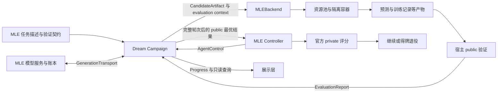
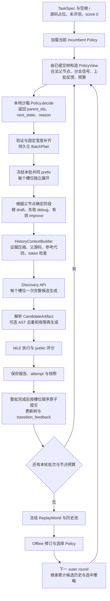
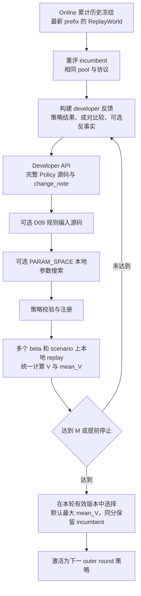

# RSI Agent 重构归属与搜索流程分析

日期：2026-10-18。代码基准：MLE `944b3a3`，Dream-RSI `d7f5e9b`；Dream 原生基线为 `3ccf88a`。本文针对当前 `src/mle_rsi/` 和 `third_party/dream-rsi/my_rsi/`，历史实验补丁位于 `legacy/`，不代表当前默认行为。

这次重构可以按“通用 RSI agent”和“MLE 实验平台”划分；通用部分再分为接口解耦、系统鲁棒性、搜索算法与上下文管理。算法部分确实覆盖 online discovery 和 offline policy search，但回放、反事实分析、参数搜索等许多能力在 Dream 原生基线中已经存在，此次主要是保留、接入、修正和补充可选规则，不能全部算作新增算法。

双方的核心闭环是 **Dream 生成候选程序，MLE 执行并在 public 数据上验证，向 Dream 返回可信评分和诊断**。Dream 的 online 优化任务程序；offline 优化选择父节点的策略程序。两类程序、两类模型请求、两类评分应分开理解。

## 重构范围与修改归属

### 本次提交范围

| 仓库与提交 | 内容 |
|---|---|
| MLE `eea9cf2` | 新平台、Controller、容器执行、public 评分、官方评分、资源和账本；旧实现归档；移除 rsi-eval submodule |
| MLE `91c89cb` | 历史迁移、独立 refresh、工作流、特征缓存、Gemini、认证 Web |
| MLE `1d739cb`、`944b3a3` | 实施与验收证据、限制和保护性检查记录 |
| Dream `5049078` | 外部任务与模型接口、批次持久化恢复、通用控制、诊断与上下文改进 |
| Dream `d7f5e9b` | 历史导出导入、独立 refresh、可选决策规则和 AST 去重 |

Dream 相对原生基线共 29 个文件变化，新增 1417 行、删除 159 行，其中包括测试；不能将这个统计当成纯算法代码量。完整文件清单见 [第二阶段验收记录](verification/phase2-acceptance.json)。

### 通用 RSI Agent

| 类别 | 此次实现或改动 | 对搜索的意义 |
|---|---|---|
| 接口解耦 | `TaskBackend`、`GenerationTransport`、`AgentControl`、`ProgressSink`，Campaign 显式装配；外部任务不初始化 Lasso evaluator/sampler | 通用搜索不依赖 MLE 数据、容器或某家模型网关 |
| 通用任务表达 | `TaskSpec.evaluation_criteria`、`EvaluationReport.metrics`；非 Lasso prompt；未评测空根不作为真实最优候选 | 分清任务质量、执行耗时和原始指标方向 |
| online 恢复 | 请求前持久化 `BatchPlan`、固定父节点和 attempt IDs、保存策略前后 JSON state | 崩溃恢复不重新选父节点，不把同一请求移到另一个分支 |
| 存储一致性 | 节点、树、批次回执和计划完成状态单 SQLite 事务提交；输入与策略哈希核验 | 防止半批提交、重复节点和历史冲突 |
| 模型故障处理 | 区分未发出、结果未知、明确允许跳过；恢复复用已保存响应；外部未知请求不盲目重发 | 降低重复付费和错误归因 |
| offline 鲁棒性 | 独立 `PolicyTimeout`，回放 worker 超时最多累计 3 次；旧超时缓存不当成有效低分；符合条件时保留已有有效 incumbent | 基础设施超时不冒充算法性能差；没有有效 incumbent 时仍会报错 |
| 上下文 | 长祖先链有界；参考代码超预算可省略且记录原因；保留父源码；更充分的运行错误信息 | 支撑长历史，给 debug 提供可操作证据 |
| online 算法可选增强 | D09 有界修复、优先修复、best-first、停滞重新 draft、fallback；D10 AST 去重及有限再生成 | 改变探索、利用、修复的分配，减少代码层面重复；默认关闭 |
| online 与 offline 一致性 | D09 写进实际注册、哈希的策略源码，online、replay、tuning 共用 | 避免线上偷偷施加规则、离线却评估另一套行为 |
| offline 修正与入口 | 反事实上界计算纳入增长后的节点预算；`Campaign.refresh(id)`；实际调参与反事实统计 | 使预算口径一致，允许只用现有历史更新策略 |
| 历史与只读接口 | 完整轮次前缀导出、新 namespace 导入、重新验证策略、`summary`/`best_result`/inspection | 支持分叉、审计和外部展示，而不直接修改核心表 |

这些能力中，批次恢复、模型状态区分、持久化等属于运行鲁棒性；D09/D10 属于搜索行为优化；上下文管理同时影响运行稳定性和生成质量。建议把“可复用性/接口”和“上下文/证据”单列，不强行把所有改动塞进鲁棒性或算法二选一。

### MLE 平台及 MLE-bench 专属部分

“位于 MLE 仓库”不等于“只适用于 MLE-bench”。资源调度、计费、模型适配等工程能力理论上可复用，但当前实现和生命周期归 MLE 平台所有。

| 类别 | 当前职责与改动 | 主要代码 |
|---|---|---|
| 任务与候选契约 | competition 描述、Python 入口、数据路径、CPU/GPU 声明、训练记录、输出格式 | [tasks.py](../src/mle_rsi/tasks.py)、[backend.py](../src/mle_rsi/backend.py) |
| public 评测 | 宿主固定划分、独立标签重算、指标方向转换、完整 submission 校验、预测重复诊断 | [validation.py](../src/mle_rsi/validation.py) |
| 任务专项处理 | Cactus/APTOS 三折、OOF 与 final refit、分组防泄漏、图像/文本/概率格式约束、任务时限 | tasks、validation、[runtime.py](../src/mle_rsi/runtime.py) |
| 候选运行 SDK | 划分与预测输出 helper、训练契约、进度与剩余时间、本地预训练模型、完整产物提交 | runtime |
| 特征缓存 | 可选、标签无关的确定性数值预处理；候选只读共享缓存，宿主核验后发布；不缓存训练模型 | [feature_cache.py](../src/mle_rsi/feature_cache.py) |
| 执行隔离 | Sysbox 容器、只读数据与依赖、输出权限/AFS 映射、超时、残留容器及测量恢复 | [containers.py](../src/mle_rsi/containers.py)、[execute.py](../src/mle_rsi/execute.py)、[recovery.py](../src/mle_rsi/recovery.py) |
| 资源管理 | CPU 兄弟线程保护、CPU/GPU 混合调度、GPU 探测、取消释放、资源租约 | [resources.py](../src/mle_rsi/resources.py) |
| 模型与计费 | Chat/Gemini 协议、共享 API 并发、HTTP 故障分类、实际账单、未知预留、API/执行/GPU 单账本、幂等追加预算 | [provider.py](../src/mle_rsi/provider.py)、[ledger.py](../src/mle_rsi/ledger.py) |
| 多题生命周期 | 每题独立 Campaign/轮次、排除题、队列、排空 pause/stop、截止时间 | [controller.py](../src/mle_rsi/controller.py) |
| 官方 private 评分 | 完整轮次后对 public 最优 submission 评分、奖牌退役；结果不传给 Campaign | [grading.py](../src/mle_rsi/grading.py) |
| 实验工作流 | development/final 阶段、guarded 门槛、历史继承、费用继承、前缀分叉 | [workflow.py](../src/mle_rsi/workflow.py)、[migration.py](../src/mle_rsi/migration.py) |
| 发布与观察 | 固定代码/配置/数据/划分/镜像身份；统一 CLI；认证 Web 展示树、代码、诊断、资源和账本 | [release.py](../src/mle_rsi/release.py)、[web.py](../src/mle_rsi/web.py) |

### 历史改动全项对应

以下沿用设计中的 C01–C26，合并两阶段最终状态；避免把首版“后置”误读为当前仍未实现。

| 历史编号 | 修改主题 | 最终归属与状态 |
|---|---|---|
| C01 | backend、任务、指标 | Dream 通用接口；MLE 实现任务与指标 |
| C02 | 模型注入、账单 | Dream transport；MLE Chat/Gemini 与账本 |
| C03 | 槽位、父节点冲突 | Dream 持久化计划与原子批次 |
| C04 | 回退与恢复 | Dream 正常恢复/历史前缀；MLE 分叉与费用继承 |
| C05 | 504、未知请求、退避 | MLE provider 识别；Dream 使用通用异常语义 |
| C06 | 长历史 | Dream 上下文与证据管理 |
| C07 | 策略/回放超时 | Dream 超时分类、有限重试与有效策略保留 |
| C08 | 修复、排序、fallback | Dream D09，可选且默认关闭 |
| C09 | 去重、实验角色 | Dream D10，可选；MLE 通过任务 instructions 表达角色 |
| C10 | 相同预测 | MLE public diagnostics，不作为拒绝 gate |
| C11 | offline 强度、反事实、refresh | MLE 配置档位；Dream 执行、预算修正、独立 refresh |
| C12 | 多题并发 | MLE Controller；Dream 每题独立 Campaign |
| C13 | 排除、退役、停止 | MLE 生命周期；Dream 通用停止点 |
| C14 | CPU/GPU | MLE 资源池 |
| C15 | 执行/测量竞态 | MLE 容器与宿主进程取证和账本 |
| C16 | AFS/权限 | MLE 运行挂载与新输出映射 |
| C17 | 预算与追加 | MLE 单账本与审计 |
| C18 | public 验证 | MLE 固定划分、独立重算与 submission 校验 |
| C19 | 三折与重复组 | MLE Cactus/APTOS 和分组协议 |
| C20 | 训练一致性、完整输出 | MLE runtime 与宿主验证；记录不能证明任意代码内部语义 |
| C21 | 时限、缓存 | MLE 每题预算与可选特征缓存 |
| C22 | 官方评分 | MLE private grader 包装 |
| C23 | 继承、跨机 | Dream 历史导入导出＋MLE 身份/费用；不支持跨机接管同一 run |
| C24 | 展示 | Dream 只读查询与进度边界；MLE CLI/Web |
| C25 | 历史启动器 | MLE 统一 CLI/workflow；旧脚本归档，不逐个复刻 |
| C26 | 版本与依赖 | MLE 固定 Dream gitlink、可安装包、必要 rsi-eval 功能迁入 |

来源：[架构设计](rsi-agent-mle-architecture-design.md)、[首版实施](platform-implementation.md)、[第二阶段实施与验收](phase2-implementation.md)。设计草案是历史方案，当前行为以代码及第二阶段记录为准。

## Dream 与 MLE 的接口

### 核心闭环和外围接口



因此，“交互就是候选方案和反馈”适合描述**内层任务求解闭环**；完整软件接口还包含以下内容：

| 接口 | 传递内容 |
|---|---|
| `TaskBackend.task` | `TaskSpec`：目标、候选契约、语言/库、评测协议、指标方向 |
| `fingerprint`、`bind` | 冻结身份、storage namespace、protocol hash；绑定 evaluator 与 sampler |
| `initial_artifact`、`bootstrap_report` | 空工作区及未评测零分根节点 |
| evaluator / sampler | `evaluate(artifact, context)`；context 包含 namespaced `evaluation_id` 和 `protocol_hash` |
| `GenerationTransport` | request ID、输入哈希、模型配置、messages、discovery/developer 角色；返回文本及 token/费用证据；支持 lookup 恢复 |
| `AgentControl` | 在 online 批次、offline 修订/调参/回放等边界检查是否停止 |
| `ProgressSink` 和查询 | 阶段事件、树/候选/公开结果等外部观察能力 |

接口定义见 [interfaces.py](../third_party/dream-rsi/my_rsi/src/dream_rsi/interfaces.py)，具体装配见 [backend.py](../src/mle_rsi/backend.py) 的 `assemble`。当前是同进程 Python 协议与方法调用，不是两个仓库之间的 HTTP 服务协议。

### 候选方案包含什么

模型每次返回一个完整候选，核心是完整源码，不只是自然语言建议，也不是仅返回 patch。解析后形成 `CandidateArtifact`：

| 字段 | 含义 |
|---|---|
| `artifact_id`、`source_hash` | 宿主形成的候选身份与源码指纹 |
| `proposal` | 方法与改动说明，是生成模型的主张，不等于验证过的收益 |
| `source` | 完整程序源码，MLE 后端写为 `agent.py` |
| `language`、`entrypoint` | 通用候选元数据；MLE 实际依契约运行 Python 脚本 |
| `mechanism_tags`、`expected_effect` | 机制标签和预期效果，供历史摘要及比较使用 |
| `schema_version` | 数据结构版本 |

父节点、draft/debug/improve、snapshot、usage refs 属于 `AttemptRecord`/`DiscoveryNode`，并不是 CandidateArtifact 的字段。评测上下文单独传入，绑定本次执行身份。

MLE 程序通过 `python /agent.py --task /task.json` 执行；源码必须声明 `MLE_RESOURCE='cpu'` 或 `'gpu'`，运行时读取数据与预算，使用固定验证协议，完成训练、验证预测及最终全量 test submission。候选容器从新输出目录启动，不继承父候选训练 checkpoint。Dream 的父源码/工作区快照用于生成与审计，不能等同于 MLE 训练状态续跑。

### 反馈包含什么

完整反馈为 `EvaluationReport`，见 [models.py](../third_party/dream-rsi/my_rsi/src/dream_rsi/models.py) 和 `MLEBackend._report/evaluate`。

| 层次 | 字段与 MLE 内容 |
|---|---|
| 是否完成及有效 | `evaluated`、`valid`；完成评估不等于候选有效，代码解析失败也可以有终态报告 |
| 搜索质量 | `score`，统一为越大越好；无效候选为 0 |
| 失败 | `fail_class`、`error`，例如 source/runtime/timeout/output contract error |
| 协议身份 | `protocol_hash`，防止不同验证口径混用 |
| 原始指标 | `metrics.raw_metric`、指标名、原始方向、scale、转换 definition、validation protocol hash |
| 执行诊断 | `diagnostics.resources`、`output_dir`、日志末尾 `stdout_tail` |
| 验证与产物 | `public_score`、`submission_sha256`、同协议预测重复信息、可选缓存发布结果 |
| 通用兼容字段 | `objective_gaps`、`timing_samples_ms`；用于原生任务，MLE 不必填充 |

例如 AUC 直接作为 score；非负 loss 使用 `1/(1+raw/scale)`；kappa 使用 `(raw+1)/2`。因此可以在通用核心里比较“越大越好”，同时保留真实原始指标。[实现](../src/mle_rsi/tasks.py)：`metric/search_score`。

宿主至少检查 `submission.csv`、`validation_predictions.csv`、`training-contract.json`、`candidate-result.json`、`validation-split.json`；训练记录与完整 submission 合格后，由宿主使用自己的 public 标签重算分数。模型自报的 `candidate-result.json` 分数不直接决定胜者。

完整 EvaluationReport 留在存储中；下一次 API 请求使用精选摘要，不会自动把全部 diagnostics 原样发送。尤其当前 evidence 模式成功父节点的 `diagnosis` 主要传有效性、转换后 score 和相对增益，没有自动展开全部 `metrics/public_score/prediction_duplicate_of`；失败父节点则会携带截断错误、stdout 和资源信息。这是“后台反馈”和“模型实际可见反馈”的区别。

### public 与 private 的边界

这里的 public 指在公开训练数据上构建的本地固定验证/三折协议，不是每个候选都向 Kaggle public leaderboard 提交。online 和 offline 使用这套公开证据。

完整 online＋offline 轮次结束后，Controller 取 public 最优 submission，调用官方 private grader；奖牌可决定是否继续投入该题，但 private 分数、标签和报告不进入 Campaign 或策略修订 prompt。因此 private 会影响外层停止决策，不作为内层算法质量反馈。[实现](../src/mle_rsi/controller.py)：`task_loop`。

## Online 从根节点到下一批候选

### 默认配置与术语

以下以 [mle-example.json](../configs/experiments/mle-example.json) 为例：`batch_size=5`、`batches=5`、`rounds=20`、`offline_tier=baseline`。batch 是一批候选；outer round 是若干批 online 加一次 offline。

MLE 装配固定 `W=5`、`K1=K2=5`、每轮 25 个节点预算、`fixed_batch_size=True`、`branching-workspaces-v3`、累计历史、只回放最新累计前缀和 `history_input.mode='evidence'`。不是所有 Dream 原生默认配置都如此。

### 内部流程图



基础设施异常会让计划保持 pending，恢复时复用同一批父节点与已完成 attempts；候选自身代码错误通常形成无效报告并作为节点提交。整批并发完成之前不会用某个先完成子节点提前决定本批其他槽位。

代码依据：[online.py](../third_party/dream-rsi/my_rsi/src/dream_rsi/online.py) `OnlineScheduler._run`、[discovery.py](../third_party/dream-rsi/my_rsi/src/dream_rsi/discovery.py) `DiscoveryAgent.expand`、[campaign.py](../third_party/dream-rsi/my_rsi/src/dream_rsi/campaign.py) `_run_round`。

### 第一批如何展开五个方案

根是 `# implement task` 的未评测脚手架，不会先训练一个基线。默认初始策略为 `workspace_policy_source`，第一次 `decide` 返回：

```text
parent_ids = [r, r, r, r, r]
```

Scheduler 建立 5 个不同 attempt ID 和独立工作区，分别调用 Discovery API。每次 API 只要求一个完整方案，总共得到最多 5 个本批终态候选。它们看到同一批开始时的历史，彼此看不到尚未提交的兄弟方案；attempt 路径不同，模型采样也可能不同，但默认没有强制的“五种模型分工”，也不能保证五个方案互不重复。AST gate 显式启用后才做结构去重。

### 输入给 Discovery API 的信息

通常为一条 system 消息与一条 JSON user 消息；不是持续追加全部历史的聊天会话。system 给出任务生成规则、候选契约和完整 JSON 输出要求。user 的主要字段如下：

| 信息 | 具体内容 |
|---|---|
| `task` | 目标描述、实验 instructions、语言/库、MLE 契约、验证 manifest、指标方向 |
| `stage`、`instruction` | 本次 draft/debug/improve 及对应指令 |
| `parent` | 父 ID、深度、子节点数、标签、proposal、诊断、源码位置 |
| `files` | 问题 JSON 和父候选完整源码；根阶段只有占位源码 |
| `path_from_root` | 每步方法变化、score、valid、相对增益；过长时保留最初 4 步和最近 28 步 |
| `tree` | 节点数、有效数、全局最佳节点与分数、根分数 |
| `mechanisms` | 最多 24 个标签族的次数、有效率、改进次数、平均增益、最佳节点、失败类型 |
| `recent_failures` | 最近 6 个失败的原因、标签与改动摘要 |
| `reference_sources` | 最多 2 个参考：最佳有效非父候选、父路径外另一机制的优秀候选；全文或更短的 diff |

根阶段路径/历史为空或极少；随着提交产生，下一批按最新 prefix 重新构建这些内容。模型不会获得 private 数据，public 数据也不是直接作为全量表格塞进 prompt：候选程序运行时读取挂载数据。

实现：[evidence_context.py](../third_party/dream-rsi/my_rsi/src/dream_rsi/evidence_context.py) `discovery_evidence`，以及 [prompting.py](../third_party/dream-rsi/my_rsi/src/dream_rsi/prompting.py) `evidence_discovery_messages`。

### 下一批从哪些父节点延伸

父节点选择由本地 Python `Policy.decide(view,state)` 完成，**这一步不调用 LLM**。LLM 负责生成选定父节点的子程序；offline 的另一个 LLM 角色负责修改 Policy 本身。

PolicyView 包含当前已揭示节点及其拓扑、分数、有效性、失败类别、源码/诊断（可配置摘要）、合法父集合、上批选了谁/揭示了谁、剩余批次/节点预算，以及分支增益、停滞长度、连续失败、修复性、距上次选择时间、深度和排名等信号。policy 还有显式 JSON state。

**默认初始策略没有按分数淘汰分支。** 第一批生成 A/B/C/D/E 后，第二批选择 `[A,B,C,D,E]`；A 有效则 improve A，B 失败则 debug B。第三批选择第二批产生的 5 个新叶子，依此类推。每个分支仍可看到全局最佳和其他机制的参考代码，所以相互借鉴并不要求共享父节点。

默认累计模式 `any_node_parents=False`，合法父节点为根和叶子；非根父节点在同批不能重复。开启 `any_node_parents=True` 后可从内部节点重新分叉，也允许同一非根父节点占据多个槽位。`initial_policy='best-first'` 是另一种可配置初始策略，不是当前默认的 workspace 策略。

每次 outer round 后，offline 选中的新 Policy 可以改变下一轮选择哪些合法父节点，决定重新 draft、debug 还是继续深挖。阶段本身由父节点状态推导，不是 Policy 单独返回一个 stage。

此外，当前 MLE 强制固定批宽：策略选不足 5 个时，`BatchValidator.fill` 先补其他合法叶子，再用根补齐；总节点预算不足才截短。因此“策略声明 width=1”不等于平台实际只发一个请求；offline 同样使用这个补齐逻辑。这一点对理解宽度调参尤其重要。

实现：[policy.py](../third_party/dream-rsi/my_rsi/src/dream_rsi/policy.py) `workspace_policy_source/best_first_policy_source`；[tree.py](../third_party/dream-rsi/my_rsi/src/dream_rsi/tree.py) `build_view/BatchValidator`。

## RSI Agent 的上下文与记忆管理

系统有三层持久信息，而不是只依赖模型聊天记忆：

| 层 | 保存什么 | 如何使用 |
|---|---|---|
| 完整证据层 | 候选源码、proposal、报告、树、attempt、模型请求/响应、usage、快照、冻结回放 world | 完整保存在宿主存储，支持重放、审计和恢复 |
| 决策状态层 | 已提交 PolicyView、分支信号、transition feedback、策略显式 JSON state、BatchPlan | 供本地策略选父节点；恢复直接恢复已保存 state，不重新 decide 已完成批次 |
| 模型上下文层 | 从完整证据中生成 discovery/developer 的摘要及必要源码 | 每次请求重新构造，按角色 token 上限控制 |

Dream 支持 full/bounded/evidence 路径；MLE 当前固定选 evidence。`HistoryContextBuilder` 收集当前父祖先链、live prefix 和 prior history，并计算 context hash；累计快照按 node ID 合并，避免同一历史节点重复统计。参考代码如果 diff 小于全文的 80%，优先用 diff，并说明 diff 所依赖的已提供全文。

默认 discovery 上限 64,000 tokens、developer 上限 96,000 tokens，同时受 `model.context_tokens - max_output_tokens` 限制。超预算时 discovery 先从末尾删除可选参考源码，记录被省略节点与原因；保留任务、父源码和必要诊断。如果仍超限，抛 `ContextOverflow`，不发送截断了必要信息的请求。

这套压缩是确定性规则和统计聚合，不是额外调用摘要 LLM，也不是向量数据库 RAG。正常跨候选请求不继承模型会话；同一候选解析失败或去重重试时，才可能追加上次回答和修正指令。显式 state 被保存，但不会持久化策略 worker 内任意 Python 隐藏全局变量。

developer 看到的是另一套摘要：树深度/父节点类型的收益统计、有效分数分位数、当前 policy 完整源码、最近 5 个策略版本结果、成对比较与一个分歧案例、反事实摘要、行为警告、目标和回放协议。它不接收每个 MLE 候选的完整训练代码。当前 `feedback['task']` 虽在 Campaign 构建，`developer_evidence` 的返回结构没有带出 task；不能声称 developer API 已拿到完整 MLE 任务说明。

实现：[workspaces.py](../third_party/dream-rsi/my_rsi/src/dream_rsi/workspaces.py)、[context.py](../third_party/dream-rsi/my_rsi/src/dream_rsi/context.py)、[evidence_context.py](../third_party/dream-rsi/my_rsi/src/dream_rsi/evidence_context.py)、[llm.py](../third_party/dream-rsi/my_rsi/src/dream_rsi/llm.py)。

## Offline Search 如何优化搜索算法

### 调用 API 的位置

| 操作 | 模型 API | MLE 候选训练 |
|---|---|---|
| 重新评估 incumbent | 不调用，执行本地 replay | 不训练 |
| developer 修订 Policy 源码 | 调用；输入策略和历史反馈，输出完整 Policy 源码与 change_note | 不训练 |
| 检查策略、历史 replay | 不调用；沙箱运行 Policy | 不训练 |
| 参数 tuning | 不调用；本地参数抽样与 replay | 不训练 |
| counterfactual 分析 | 不调用；替换决策后重新 replay | 不训练 |
| 选中策略 | 不调用；比较有效回放结果 | 不训练 |
| 独立 refresh | 复用上述流程，可能有 developer API | 不新增候选、不增加 online 轮数 |

所以 offline 不是“完全不联网/不花 API 费用”；它的“离线”指只用已有公开候选历史评估策略，不额外执行新 MLE 候选。mock responder、缓存恢复或固定探索等配置下可能没有实际网络请求。

### Offline 内部流程图



版本 0 是 incumbent 的重新评估，后面才是模型修订版本。每次有效修订可成为下一次修订的 base，即使它未胜过 incumbent；最后再统一选胜者。比较要求相同 frozen pool 和 comparison hash，不能混用旧历史或旧预算的分数。[实现](../third_party/dream-rsi/my_rsi/src/dream_rsi/campaign.py)：`_dream`；[registry.py](../third_party/dream-rsi/my_rsi/src/dream_rsi/registry.py)：`PolicySelector`。

### Replay 并非重新生成候选

宿主持有完整冻结树，但被评估的 Policy 每一步只看当前已经揭示的 prefix。策略请求扩展父节点，replay 就从历史中找这个父节点尚未揭示的真实子节点，将其既有分数和诊断揭示给策略，然后继续决策。重复这个过程，估计同样预算下该策略能多早、以多少探索找到多好的结果。

这能改变历史节点的访问顺序，不能知道“在当时从某父节点重新调用 LLM”实际会生成什么。历史树存在采样偏差，replay 改善不自动等价于真实 online 或奖牌收益。

遇到未记录子节点的动作，核心支持 `refill`、`graft`、`virtual` 等模式：默认 refill 请求其他合法动作；graft 跳到已记录的邻近节点并标注借用；virtual 根据历史统计模拟子节点并显式标注。后两者都不是新执行的真实候选，也不调用 LLM。当前 MLE 示例默认 `replay_missing_action='refill'`、`replay_free_refill=True`，不能把虚拟节点机制写成默认开启。[实现](../third_party/dream-rsi/my_rsi/src/dream_rsi/replay.py)：`ReplayEpisode.advance`。

### 策略评价目标与选择

原生默认目标为：

```text
V = best_revealed_score - beta1 × N + beta2 × N / max(1, k)
mean_V = 在 world × scheduling_beta × scenario 的回放结果上等权平均
```

N 是揭示的非根节点数，k 是非空批次数。它综合最好质量、探索工作量及批量效率；这里的 `beta1/beta2` 与传入策略的 `scheduling_beta` 是不同概念。`scheduling_beta` 用于测试策略在不同调度偏好下的行为。

**当前 MLE 空根 score=0；如果不显式设置 beta1/beta2，bootstrap 用根分数推导出的二者也都为 0。** 因此当前默认目标实际上退化为最高揭示分数，不包含非零的节点成本惩罚。这是代码配置的结果，不应把默认描述成已经实现质量与美元成本的最优权衡；美元和 GPU 预算在 MLE 账本外层约束。

原生还支持 root gain、anytime AUC、虚拟证据折扣、paired bootstrap 保守策略选择等；这些均不是本次新发明，也不由 `offline_tier=max` 自动全部开启。当前默认为 best/endpoint/argmax。同分不换 incumbent。

### Tuning 与反事实如何改进策略

Tuning 要求模型在 `Policy` 类里声明数值参数和 `PARAM_SPACE`，例如 anchor 数、停滞耐心、探索权重。宿主先试当前值，再做有确定种子的随机抽样，用独立于正式评估的 replay scenario seeds 选值，写回源码，随后注册、评估和部署同一份源码。没有声明参数空间时不会凭空产生 12 或 48 次有效调参；档位是上限/配置，不是实际完成数。[实现](../third_party/dream-rsi/my_rsi/src/dream_rsi/tuning.py)。

反事实分析选择少量 episode 和早期步骤，把某一批的第一个父节点替换为另一个合法父节点，保持同一策略继续跑到结束，比较 `delta_V`，估计该次选择的 regret。摘要告诉 developer 哪类决策错失了收益；它用于生成修订反馈，不直接替代正式策略选择分数。本次修正让其可达收益上界使用与 replay 相同的 budget-growth 参数。[实现](../third_party/dream-rsi/my_rsi/src/dream_rsi/counterfactual.py)。

因此策略自我改进的对象是“下一个预算槽位给谁”：何时重新从根探索、继续高分分支、修复失败、放弃停滞、复用优秀 anchor。没有对基础 LLM 做权重训练或强化学习更新；优化产物是可执行的 Python Policy 源码及其参数。

### 三个 Offline 档位

| 参数 | baseline | light | max |
|---|---:|---:|---:|
| M，含 incumbent 的版本数 | 2 | 3 | 5 |
| 正常情况下新增 developer 修订请求数 | 1 | 2 | 4 |
| 每次修订配置的 tuning trials | 0 | 12 | 48 |
| tuning scenarios | 不启用 tuning | 2 | 4 |
| 正式 replay scenarios | 4 | 2 | 4 |
| replay node budget growth | 未设置 | 0.2 | 0.7 |
| counterfactual episodes | 0 | 1 | 4 |
| 每 episode 反事实 steps | 不启用 | 4 | 8 |
| 每 step alternatives | 不启用 | 2 | 3 |

这些值来自 [config.py](../src/mle_rsi/config.py) 的 `OFFLINE`，`search` 可覆盖相应参数。API 次数不含解析/传输重试；早停、失败、已完成记录复用会改变实际次数。默认 beta sweep 是 0 至 1 的 21 个值，因此 baseline 在一个最新累计 world 上，每个策略通常有 21×4=84 个本地 replay episode，而不是 84 次 LLM 请求。

## 原生能力与此次优化的边界

| 能力 | 原生基线已有 | 此次新增或修正 |
|---|---|---|
| online 树扩展、独立工作区、Policy 选父节点 | 是 | 外部 backend、批次可靠恢复、通用指标 |
| 累计历史、evidence 摘要、参考源码 diff | 是 | 祖先长度上限、超预算省略参考、MLE 失败诊断 |
| best-first、any-node、beta/scenario 回放 | 是 | 保留可配置能力；不是全都默认启用 |
| developer 改策略、参数 tuning、反事实、paired analysis | 是 | 档位在 MLE 接入；反事实上界修正、回放超时处理 |
| root-gain、anytime、virtual/graft、paired bootstrap | 是 | 保留；当前默认配置未启用这些替代模式 |
| D09 修复/探索/fallback 统一规则 | 否，当前新增 decision_rules 模块 | 显式 opt-in，编入统一策略源码 |
| D10 Python AST gate | 否，当前新增 novelty 模块 | 语法结构去重，保留常量；不是语义等价检测 |
| 可移植历史、独立 refresh | 当前新增接口与实现 | MLE 进一步管理费用、submission、工作流和 CLI |

这一判断来自 Dream `git diff 3ccf88a..d7f5e9b`：`policy.py`、`tuning.py`、`developer.py` 等核心算法文件并没有在本次变化，`replay.py` 的改动主要集中于超时恢复，而不是重新设计回放搜索算法。

## 验证范围与后续判断依据

现有第二阶段验收包括定向回归 50 passed/2 opt-in skipped、浏览器 1 passed、原生 Dream 定向回归 17 passed、真实 Leaf 候选闭环、微型 GPU 执行、干净安装、历史导入导出和保护性哈希检查。具体范围见 [第二阶段实施与验收](phase2-implementation.md)；这些是既有验收记录，本次文档研究没有重新运行付费 API 或训练任务。

真实 Gemini 网关、完整 Cactus/APTOS 三折训练、长时 GPU 稳定性、大规模 max 收益和所有故障组合不在这些证据覆盖内。D09/D10、缓存和更强 offline 的存在不能直接写成已经提高奖牌率，需要固定任务、预算和验证协议的对照实验。

目前最值得在实验解释中明确的四点是：默认 online 先沿五条分支分别推进；固定批宽会覆盖策略缩小批宽的意图；默认零分根使 beta1/beta2 成本项为零；完整 public diagnostics 并不全部进入 discovery/developer prompt。理解这四点后，才能准确判断一次改进究竟来自候选生成、父节点调度、offline 策略更新，还是 MLE 执行与评测工程。
